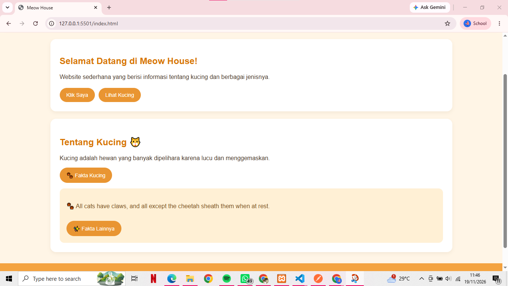

# 🐱 Meow House

**Meow House** merupakan website yang menyediakan informasi seputar kucing, mulai dari pengenalan kucing, berbagai jenis ras kucing, hingga fakta-fakta unik tentang kucing. Website ini dibuat menggunakan HTML, CSS, dan JavaScript serta dilengkapi dengan integrasi API.

## 📌 Fitur Website

1. **Home**  
   Menampilkan halaman utama yang berisi sambutan dan pengenalan singkat mengenai website Meow House.

2. **Interaksi JavaScript**  
   Menyediakan tombol interaktif yang dapat digunakan pengguna untuk melihat perubahan teks pada halaman Home.

3. **Jenis-Jenis Kucing**  
   Menampilkan informasi mengenai tiga jenis ras kucing, yaitu:
   - Persia
   - British Shorthair
   - Siamese

4. **Integrasi API**  
   Menggunakan Cat Fact Ninja API untuk mengambil dan menampilkan fakta unik tentang kucing.

5. **Navigasi Halaman**  
   Memudahkan pengguna berpindah antara halaman Home dan Jenis-Jenis Kucing.

## 🛠️ Teknologi yang Digunakan

- **HTML** – Membuat struktur halaman website.
- **CSS** – Mengatur tampilan dan desain website.
- **JavaScript** – Membuat interaksi dan menjalankan fungsi website.
- **Cat Fact Ninja API** – Mengambil data fakta unik tentang kucing.

## 📸 Dokumentasi Website

### 1. Halaman Home

Menampilkan tampilan utama website Meow House yang berisi sambutan dan pengenalan mengenai kucing.


### 2. Implementasi JavaScript

Menunjukkan keberhasilan fungsi JavaScript melalui tombol interaktif pada halaman Home.


### 3. Halaman Jenis-Jenis Kucing

Menampilkan informasi mengenai tiga jenis kucing, yaitu Persia, British Shorthair, dan Siamese.


### 4. Implementasi API

Menunjukkan keberhasilan integrasi API dalam mengambil dan menampilkan fakta unik tentang kucing.



## 🌐 API yang Digunakan

Website ini menggunakan **Cat Fact Ninja API** untuk memperoleh informasi berupa fakta unik tentang kucing.

URL API: https://catfact.ninja/fact

## 📂 Struktur Project

```text
web kucing/
│
├── dokumentasi/
│   ├── API.png
│   ├── home js.png
│   ├── home.png
│   └── jenis jenis kucing.png
│
├── images/
│
├── index.html
├── cats.html
├── style.css
├── script.js
└── README.md
```

## 🚀 Cara Menjalankan Website

1. Clone repository:

   ```bash
   git clone https://github.com/rayyaarra/tugas-kelas-pem-web.git
   ```

2. Buka folder project menggunakan Visual Studio Code.
3. Jalankan file `index.html` menggunakan ekstensi Live Server.
4. Website dapat diakses melalui browser.

## 👩‍💻 Pengembang

Project Meow House dibuat untuk memenuhi tugas mata kuliah Pemrograman Web.