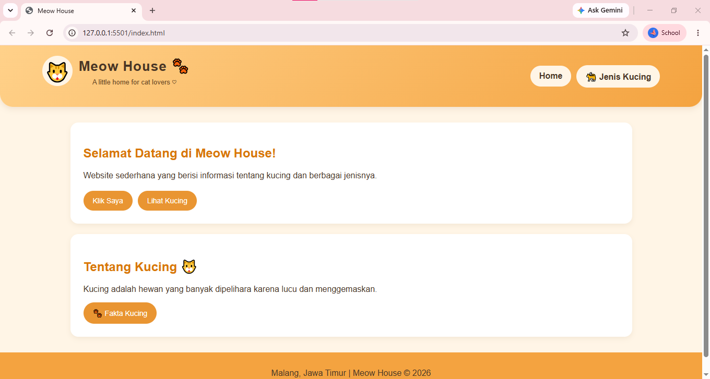

# 🐱 Meow House

**Meow House** merupakan website sederhana yang dibuat untuk memberikan informasi seputar kucing. Website ini menyediakan informasi mengenai beberapa jenis ras kucing serta fakta-fakta unik tentang kucing yang dapat diakses secara interaktif.

## 📌 Fitur Website

1. **Home**  
   Halaman utama yang menampilkan sambutan dan pengenalan singkat tentang website Meow House.

2. **Interaksi Tombol**  
   Pengguna dapat menekan tombol "Klik Saya" untuk mengubah teks sambutan pada halaman utama.

3. **Informasi Jenis Kucing**  
   Menampilkan tiga jenis ras kucing, yaitu:
   - Kucing Persia
   - British Shorthair
   - Kucing Siamese

4. **Fakta Kucing**  
   Menampilkan fakta unik tentang kucing menggunakan API dari Cat Fact Ninja.

5. **Navigasi Halaman**  
   Menyediakan navigasi untuk berpindah antara halaman Home dan Jenis Kucing.

## 🛠️ Teknologi yang Digunakan

- **HTML** – Membuat struktur halaman website.
- **CSS** – Mengatur tampilan dan desain website.
- **JavaScript** – Menambahkan interaksi dan fungsi pada website.
- **Cat Fact Ninja API** – Mengambil fakta unik tentang kucing secara dinamis.

## 📸 Dokumentasi Website

### 1. Halaman Home

Menampilkan halaman utama Meow House yang berisi sambutan dan pengenalan singkat mengenai kucing.



### 2. Halaman Jenis-Jenis Kucing

Menampilkan tiga jenis ras kucing, yaitu Persia, British Shorthair, dan Siamese.


### 3. Fitur Fakta Kucing

Menampilkan fakta unik tentang kucing melalui integrasi Cat Fact Ninja API.


## 📂 Struktur Folder

```text
web kucing/
│
├── dokumentasi/
│   ├── home.png
│   ├── jenis-kucing.png
│   └── fakta-kucing.png
│
├── images/
│   ├── persia.jpg
│   ├── british-shorthair.jpg
│   └── siamese.jpg
│
├── index.html
├── cats.html
├── style.css
├── script.js
└── README.md
```

## 🚀 Cara Menjalankan Website

1. Clone repository ke komputer:

   ```bash
   git clone https://github.com/rayyaarra/tugas-kelas-pem-web.git
   ```

2. Buka folder project menggunakan Visual Studio Code.

3. Jalankan file `index.html` menggunakan ekstensi Live Server.

4. Website akan terbuka secara otomatis melalui browser.

## 🌐 API

Website ini menggunakan Cat Fact Ninja API untuk mendapatkan fakta unik tentang kucing.

URL API: https://catfact.ninja/fact

## 👩‍💻 Pengembang

Project ini dibuat sebagai bagian dari tugas mata kuliah Pemrograman Web.